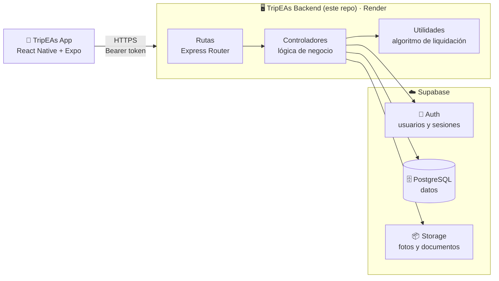
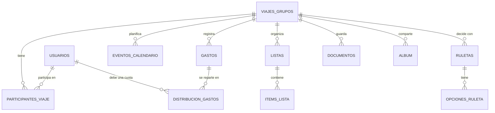
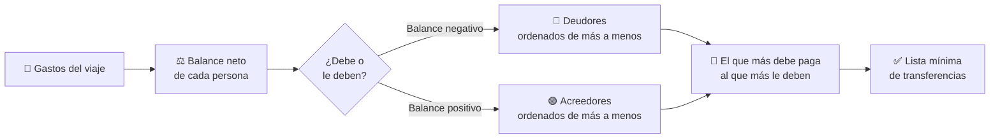

<div align="center">

# 🖥️ TripEAs · Backend

### La API que da vida a TripEAs

API REST de **TripEAs**, la app para organizar viajes en grupo. Gestiona usuarios, viajes, participantes, gastos y su liquidación, calendario, listas, ruletas, documentos y álbum de fotos.

*Trabajo de Fin de Máster · Máster en Desarrollo de Aplicaciones Web*

> 🧩 Este repositorio contiene el **backend**. La app móvil está en **[TripEAs-app](https://github.com/angelalop03/TripEAs-app)**.

<br/>

[](https://angelalop03.github.io/TripEAs-Web/)
[](https://github.com/angelalop03/TripEAs-app)

<br/>


</div>

---

## 📖 Índice

- [Qué hace este backend](#-qué-hace-este-backend)
- [Arquitectura](#️-arquitectura)
- [Tecnologías](#️-tecnologías)
- [Modelo de datos](#️-modelo-de-datos)
- [Endpoints](#-endpoints)
- [El algoritmo de liquidación](#-el-algoritmo-de-liquidación)
- [Reglas de negocio](#-reglas-de-negocio)
- [Seguridad](#-seguridad)
- [Tests](#-tests)
- [Estructura del proyecto](#-estructura-del-proyecto)
- [Ejecutar en local](#-ejecutar-en-local)
- [Despliegue](#️-despliegue)
- [Ecosistema TripEAs](#-ecosistema-tripeas)

---

## 🎯 Qué hace este backend

Es el cerebro de TripEAs: la app móvil no guarda los datos del viaje, sino que se los pide a esta API. Se encarga de:

| | Módulo | Responsabilidad |
|:-:|---|---|
| 🔐 | **Autenticación** | Registro, inicio de sesión y cambio de contraseña |
| 👤 | **Usuarios** | Perfil y foto de perfil |
| 🧳 | **Viajes** | Crear viajes, listarlos, unirse con código de invitación, editar datos y portada |
| 👥 | **Participantes** | Miembros del viaje, perfiles provisionales y reclamación de identidad |
| 💸 | **Gastos** | Registrar gastos con su reparto y calcular quién debe a quién |
| 📅 | **Calendario** | Planes y actividades del viaje |
| ✅ | **Listas** | Listas compartidas y sus elementos |
| 🎡 | **Ruleta** | Crear ruletas de decisión y girarlas |
| 📄 | **Documentos** | Subir y gestionar PDFs del viaje |
| 🖼️ | **Álbum** | Subir y gestionar fotos y vídeos |

---

## 🏗️ Arquitectura



El proyecto sigue una **estructura por capas**:

1. **Rutas** (`src/routes`): definen qué URL y método atiende cada operación.
2. **Controladores** (`src/controllers`): validan la petición, comprueban permisos y hablan con Supabase.
3. **Utilidades** (`src/utils`): lógica pura y testeable, como el algoritmo de liquidación de gastos.

Además, la creación de la app de Express (`app.js`) está **separada del arranque del servidor** (`index.js`). Así los tests pueden importar la app y lanzarle peticiones sin abrir un puerto real.

---

## 🛠️ Tecnologías

| Herramienta | Para qué la uso |
|---|---|
| **Node.js** | Entorno de ejecución del servidor |
| **Express 5** | Framework para construir la API REST |
| **Supabase** | Base de datos PostgreSQL, autenticación de usuarios y almacenamiento de archivos |
| **Multer** | Recibir archivos subidos (fotos, vídeos y PDFs) |
| **CORS** | Permitir peticiones desde la app y la versión web |
| **dotenv** | Cargar las claves desde variables de entorno |
| **Jest + Supertest** | Tests unitarios y de integración |
| **Nodemon** | Reiniciar el servidor automáticamente al desarrollar |
| **Render** | Alojamiento de la API |

---

## 🗄️ Modelo de datos



| Tabla | Contenido |
|---|---|
| `usuarios` | Datos de perfil de cada usuario (también los provisionales) |
| `viajes_grupos` | Viajes: nombre, fechas, portada y código de invitación |
| `participantes_viaje` | Quién está en cada viaje y con qué rol (`admin` o `miembro`) |
| `gastos` · `distribucion_gastos` | Cada gasto, quién lo pagó y la cuota de cada participante |
| `eventos_calendario` | Planes y actividades del viaje |
| `listas` · `items_lista` | Listas compartidas y sus elementos |
| `ruletas` · `opciones_ruleta` | Ruletas de decisión y sus opciones |
| `documentos` | PDFs del viaje |
| `album` | Fotos y vídeos del viaje |

Los archivos se guardan en **Supabase Storage**, en los buckets `documentos` y `album`.

---

## 🔌 Endpoints

Todas las rutas cuelgan de `/api`. Salvo registro e inicio de sesión, **todas requieren** la cabecera:

```http
Authorization: Bearer <token>
```

<details>
<summary><b>🔐 Auth · <code>/api/auth</code></b></summary>

<br/>

| Método | Ruta | Descripción |
|:-:|---|---|
| `POST` | `/registro` | Crear una cuenta nueva |
| `POST` | `/login` | Iniciar sesión y obtener el token |
| `PUT` | `/cambiar-password` | Cambiar la contraseña (pide la actual) |

</details>

<details>
<summary><b>👤 Usuarios · <code>/api/usuarios</code></b></summary>

<br/>

| Método | Ruta | Descripción |
|:-:|---|---|
| `GET` | `/perfil` | Obtener el perfil del usuario |
| `PUT` | `/perfil` | Actualizar el perfil |
| `POST` | `/subir-foto-perfil` | Subir foto de perfil |

</details>

<details>
<summary><b>🧳 Viajes · <code>/api/viajes</code></b></summary>

<br/>

| Método | Ruta | Descripción |
|:-:|---|---|
| `POST` | `/crear` | Crear un viaje (quien lo crea pasa a ser admin) |
| `GET` | `/mis-viajes` | Listar los viajes del usuario |
| `POST` | `/unirse` | Unirse a un viaje con el código de invitación |
| `POST` | `/subir-portada` | Subir la foto de portada |
| `GET` | `/:id_viaje` | Obtener los datos de un viaje |
| `PUT` | `/:id_viaje` | Editar nombre, fechas o portada (solo admin) |

</details>

<details>
<summary><b>👥 Participantes · <code>/api/participantes</code></b></summary>

<br/>

| Método | Ruta | Descripción |
|:-:|---|---|
| `GET` | `/:id_viaje` | Listar los participantes de un viaje |
| `POST` | `/anadir-fantasma` | Añadir un participante provisional (solo admin) |
| `POST` | `/reclamar-identidad` | Fusionar un perfil provisional con un usuario real |

</details>

<details>
<summary><b>💸 Gastos · <code>/api/gastos</code></b></summary>

<br/>

| Método | Ruta | Descripción |
|:-:|---|---|
| `POST` | `/registrar` | Registrar un gasto con su reparto |
| `GET` | `/:id_viaje` | Listar los gastos del viaje |
| `GET` | `/:id_viaje/liquidacion` | Calcular quién debe a quién con el mínimo de transferencias |

Ejemplo de cuerpo para registrar un gasto:

```json
{
  "id_viaje": "…",
  "concepto": "Cena en la playa",
  "monto_total": 60,
  "distribucion": [
    { "id_usuario": "…", "cuota": 20 },
    { "id_usuario": "…", "cuota": 20 },
    { "id_usuario": "…", "cuota": 20 }
  ]
}
```

</details>

<details>
<summary><b>📅 Calendario · <code>/api/calendario</code></b></summary>

<br/>

| Método | Ruta | Descripción |
|:-:|---|---|
| `POST` | `/crear` | Crear un plan |
| `GET` | `/:id_viaje` | Listar los planes del viaje |
| `PUT` | `/:id_evento` | Editar un plan |
| `DELETE` | `/:id_evento` | Borrar un plan |

</details>

<details>
<summary><b>✅ Listas · <code>/api/listas</code></b></summary>

<br/>

| Método | Ruta | Descripción |
|:-:|---|---|
| `POST` | `/crear` | Crear una lista |
| `GET` | `/:id_viaje` | Listar las listas con sus elementos |
| `POST` | `/items/anadir` | Añadir un elemento a una lista |
| `PATCH` | `/items/:id_item/completar` | Marcar un elemento como hecho |

</details>

<details>
<summary><b>🎡 Ruleta · <code>/api/ruleta</code></b></summary>

<br/>

| Método | Ruta | Descripción |
|:-:|---|---|
| `POST` | `/crear` | Crear una ruleta con sus opciones |
| `GET` | `/:id_viaje` | Listar las ruletas del viaje |
| `POST` | `/:id_ruleta/girar` | Girar la ruleta y obtener la opción ganadora |

</details>

<details>
<summary><b>📄 Documentos · <code>/api/documentos</code></b></summary>

<br/>

| Método | Ruta | Descripción |
|:-:|---|---|
| `POST` | `/subir` | Subir un PDF |
| `GET` | `/:id_viaje` | Listar los documentos del viaje |
| `DELETE` | `/:id_documento` | Borrar un documento |

</details>

<details>
<summary><b>🖼️ Álbum · <code>/api/album</code></b></summary>

<br/>

| Método | Ruta | Descripción |
|:-:|---|---|
| `POST` | `/subir` | Subir una foto o un vídeo |
| `GET` | `/:id_viaje` | Listar el álbum del viaje |
| `DELETE` | `/:id_archivo` | Borrar un archivo (solo quien lo subió) |

</details>

---

## 🧮 El algoritmo de liquidación

Cuando un grupo comparte muchos gastos, saldar cuentas "uno a uno" genera decenas de transferencias. TripEAs las reduce al mínimo con un algoritmo basado en **teoría de grafos** (`src/utils/liquidacionGastos.js`).



1. **Balance neto:** quien paga suma lo que adelantó y cada participante resta su cuota. Un balance positivo significa que le deben dinero; uno negativo, que debe.
2. **Separar y ordenar:** se forman dos grupos, deudores y acreedores, ordenados de mayor a menor importe.
3. **Estrategia voraz:** en cada paso, el que más debe paga al que más le deben la cantidad más grande posible. Quien queda a cero sale de la lista.
4. **Redondeo:** los importes se redondean a céntimos para evitar errores de coma flotante.

> **Ejemplo:** Ana pagó 90 € de cena para tres. Luis pagó 30 € de gasolina para los tres. Sin optimizar habría cuatro transferencias cruzadas; con el algoritmo quedan solo dos: Luis le paga 10 € a Ana y Marta le paga 40 € a Ana.

---

## 📏 Reglas de negocio

- **Roles por viaje:** quien crea un viaje es su **admin**. Solo el admin puede editar sus datos y añadir participantes provisionales. El resto entra como **miembro**.
- **Código de invitación:** cada viaje recibe un código aleatorio de 8 caracteres generado con `crypto`. Para unirse basta con introducirlo, sin distinguir mayúsculas.
- **Participantes provisionales ("fantasmas"):** el admin puede añadir a alguien que todavía no tiene cuenta, para poder apuntarle gastos desde el primer día.
- **Reclamar identidad:** cuando esa persona se registra, puede quedarse con su perfil provisional y hereda todos sus gastos e historial.
- **Cuadre de gastos:** al registrar un gasto, la suma de las cuotas debe coincidir con el importe total. Si no, la API lo rechaza.
- **Archivos:** los documentos solo admiten **PDF**. El álbum admite imágenes (JPG, PNG, WebP) y vídeo MP4. Hay límites de tamaño en las subidas.
- **Borrado del álbum:** solo quien subió un archivo puede eliminarlo.

---

## 🔒 Seguridad

<details>
<summary><b>🔑 Autenticación con Supabase Auth</b></summary>

<br/>

El registro y el inicio de sesión usan **Supabase Auth**. En cada petición protegida, el backend lee el token de la cabecera `Authorization` y lo valida con Supabase antes de hacer nada. Si no es válido, responde **401** y la app cierra la sesión.

</details>

<details>
<summary><b>🛡️ La clave privada nunca sale del servidor</b></summary>

<br/>

El backend usa la **service role key** de Supabase, que tiene permisos totales. Por eso vive solo en el servidor, en variables de entorno, y nunca se manda a la app móvil. Los permisos se comprueban en los controladores (por ejemplo, si el usuario es admin del viaje).

</details>

<details>
<summary><b>🐛 Un bug sutil resuelto: sesiones mezcladas</b></summary>

<br/>

Las funciones de login de Supabase **guardan la sesión dentro del cliente** que las llama. Al principio se usaba el mismo cliente compartido para todo el servidor, así que en cuanto alguien iniciaba sesión, el cliente dejaba de tener permisos de administrador para el resto de usuarios y fallaban las subidas de archivos.

**Solución:** el registro y el login usan un **cliente nuevo y desechable** en cada petición, con la clave pública. El cliente con permisos de administrador nunca se toca.

</details>

<details>
<summary><b>↩️ Registro todo-o-nada</b></summary>

<br/>

Registrar un usuario son dos pasos: crearlo en Supabase Auth y crear su fila en la tabla `usuarios`. Si el segundo falla, el primero se **deshace automáticamente**. Así no quedan cuentas "huérfanas" que bloquearían ese email para siempre.

</details>

<details>
<summary><b>🔁 Cambio de contraseña seguro</b></summary>

<br/>

Para cambiar la contraseña hay que dar la actual, que se comprueba volviendo a iniciar sesión en un cliente desechable. La nueva debe tener **al menos 8 caracteres**.

</details>

---

## 🧪 Tests

Tests con **Jest** y **Supertest**, centrados en los flujos críticos de la app. Supabase se sustituye por un *mock*, así que los tests no necesitan conexión ni tocan datos reales.

| Tipo | Archivo | Qué comprueba |
|---|---|---|
| 🔬 Unitario | `liquidacionGastos.test.js` | Cálculo de balances y transferencias mínimas |
| 🔬 Unitario | `reclamarIdentidad.test.js` | Fusión de un perfil provisional con un usuario real |
| 🔗 Integración | `registro.test.js` | Alta de usuario |
| 🔗 Integración | `cambiarPassword.test.js` | Cambio de contraseña |
| 🔗 Integración | `unirseAViaje.test.js` | Unirse a un viaje con código |
| 🔗 Integración | `registrarGasto.test.js` | Crear un gasto compartido |

```bash
npm test             # ejecuta todos los tests
npm run test:watch   # los vuelve a ejecutar al guardar cambios
```

---

## 📁 Estructura del proyecto

```
TripEAs-backend/
├── src/
│   ├── index.js                  # Arranca el servidor
│   ├── app.js                    # Configura Express y monta las rutas
│   ├── config/
│   │   └── supabaseClient.js     # Cliente de Supabase con la service role key
│   ├── routes/                   # Una ruta por módulo
│   │   ├── authRoutes.js · usuariosRoutes.js · viajesRoutes.js
│   │   ├── participantesRoutes.js · gastosRoutes.js · calendarioRoutes.js
│   │   └── listasRoutes.js · ruletaRoutes.js · documentosRoutes.js · albumRoutes.js
│   ├── controllers/              # Lógica de negocio de cada módulo
│   └── utils/
│       └── liquidacionGastos.js  # 🧮 Algoritmo de liquidación
├── tests/
│   ├── helpers/                  # Mock de Supabase
│   ├── unit/                     # Tests unitarios
│   └── integration/              # Tests de integración
├── render.yaml                   # Configuración de despliegue en Render
└── package.json
```

---

## 💻 Ejecutar en local

**Requisitos:** Node.js 20 o superior, npm y un proyecto de [Supabase](https://supabase.com).

```bash
# 1. Clonar el repositorio
git clone https://github.com/angelalop03/TripEAs-backend.git
cd TripEAs-backend

# 2. Instalar dependencias
npm install
```

**3.** Crea un archivo `.env` en la raíz con tus claves de Supabase:

```env
SUPABASE_URL=https://tu-proyecto.supabase.co
SUPABASE_ANON_KEY=tu-anon-key
SUPABASE_SERVICE_ROLE_KEY=tu-service-role-key
PORT=3000
```

> ⚠️ El archivo `.env` está en `.gitignore`. Nunca subas la service role key al repositorio.

```bash
# 4. Arrancar en modo desarrollo
npm run dev
```

La API queda en `http://localhost:3000`. Si abres esa dirección verás un mensaje confirmando que funciona.

| Comando | Descripción |
|---|---|
| `npm run dev` | Arranca con Nodemon (se reinicia al guardar) |
| `npm start` | Arranca en modo producción |
| `npm test` | Ejecuta los tests |
| `npm run test:watch` | Tests en modo observación |

> 📱 Para probarla desde el móvil con la app en local, usa la IP de tu ordenador en la red (por ejemplo `http://192.168.x.x:3000/api`) como `EXPO_PUBLIC_API_URL` en la app.

---

## ☁️ Despliegue

La API está desplegada en **Render**, configurada con el archivo `render.yaml`:

- **Instalación:** `npm install`
- **Arranque:** `npm start`
- **Variables de entorno:** `SUPABASE_URL`, `SUPABASE_ANON_KEY` y `SUPABASE_SERVICE_ROLE_KEY`, que se rellenan en el panel de Render y no en el repositorio.

> 💤 Está en el plan gratuito de Render, que **apaga el servidor tras un rato sin uso**. La primera petición después puede tardar entre 30 y 50 segundos. La app está preparada para esperar ese tiempo sin dar error.

---

## 🧩 Ecosistema TripEAs

| Repositorio | Descripción |
|---|---|
| 🖥️ **[TripEAs-backend](https://github.com/angelalop03/TripEAs-backend)** | Backend: esta API REST |
| 📱 **[TripEAs-app](https://github.com/angelalop03/TripEAs-app)** | Frontend: la app móvil (React Native + Expo) |
| 🌐 **[TripEAs-Web](https://github.com/angelalop03/TripEAs-Web)** | Web de presentación del proyecto |

---

<div align="center">

### 👩‍💻 Desarrollado por **Ángela López Oliva**

Trabajo de Fin de Máster · Máster en Desarrollo de Aplicaciones Web · Universidad Europea

[](https://github.com/angelalop03)
[](https://portfolio-v2-rosy-eight.vercel.app/)

⭐ Si te ha gustado, ¡déjale una estrella al repo!

</div>
